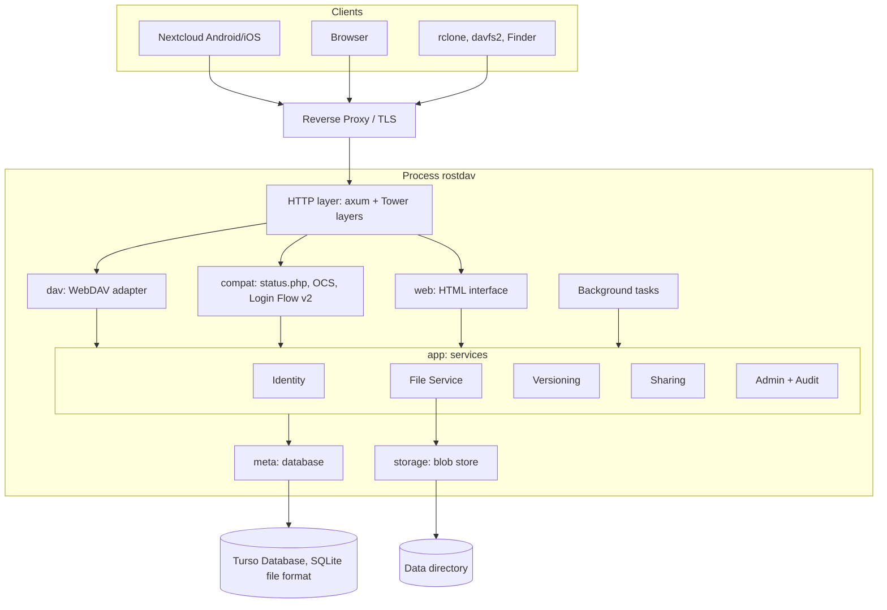

# Architecture

Status: proposal from phase 1, subject to approval of [ADR 0001](adr/0001-technology-stack.md) and [ADR 0002](adr/0002-storage-model.md).

## Overview

Rostdav is a modular monolith: one process, one binary, clearly separated crates in a Cargo workspace. The dependency direction always points inward (protocols → services → domain); the compiler enforces it across crate boundaries.

## Crates

| Crate | Responsibility | May depend on |
|---|---|---|
| `rostdav-core` | Domain types (`UserId`, `NodeId`, `Etag`, `Permissions`, `LogicalPath`), error types, validation of names and paths | – |
| `rostdav-meta` | Schema, migrations, repositories for all tables | core |
| `rostdav-storage` | `BlobStore` trait, implementation for the local file system, temporary files, atomic placement | core |
| `rostdav-app` | Services: Identity, File Service, Versioning, Sharing, Admin, Audit, background tasks; authorization | core, meta, storage |
| `rostdav-dav` | WebDAV methods, PROPFIND/PROPPATCH XML, Nextcloud properties, chunked upload | core, app |
| `rostdav-compat` | `status.php`, capabilities, OCS endpoints (user, sharing), Login Flow v2 | core, app |
| `rostdav-web` | HTML pages (askama), sessions, CSRF, static assets | core, app |
| `rostdav` (binary) | Configuration, wiring, router, CLI (`serve`, `admin …`) | all |

Rule: protocol crates know neither the database nor the file system. Only `rostdav-app` coordinates `meta` and `storage`.

## Request handling

Tower layers in this order:

1. **Request ID and tracing** – every request gets an ID; log fields are redacted centrally (`Authorization`, cookies, tokens).
2. **Limits** – header size, body limit per route (small for XML, large for uploads), timeouts.
3. **Trusted proxy** – take client IP and scheme only from configured proxies.
4. **Authentication** – produces a `Principal`:
   - Basic Auth with **app password** → `Principal { user, via: AppPassword(id) }`
   - Basic Auth with **account password** → only allowed if neither 2FA is active nor "WebDAV with app passwords only" is set
   - Session cookie → only for `rostdav-web`
   - Public link token → restricted principal for the share
5. **Rate limiting** – per IP and per username on all sign-in paths, including login flow polling and 2FA codes.
6. **CSRF** – only for state-changing web routes.
7. **Handler** → service → authorization → result → error mapping.

### Error mapping

A central error type in `rostdav-core` (`NotFound`, `Forbidden`, `Conflict`, `PreconditionFailed`, `QuotaExceeded`, `Locked`, `TooLarge`, `BadRequest`, `Unavailable`, `Internal`). Each protocol layer maps it:

- WebDAV: status codes per RFC 4918, `<d:error>` body as in Nextcloud (take the format from recordings in M5)
- OCS: envelope with v1/v2 status codes
- Web: error page without internal details

`Internal` is logged with the request ID; the client sees only the ID.

## Authorization

- Every operation receives `(Principal, NodeId, Action)`. The effective permissions result from ownership or share (permission bitmask as in Nextcloud: read, update, create, delete, share).
- Paths are used only for resolution; the check is performed on the resolved node.
- A single function `authorize()` in `rostdav-app`; no handler checks on its own. Negative tests cover every action.

## Path resolution

1. Percent-decode the URL path (exactly once), enforce UTF-8.
2. Split into segments; reject empty segments, `.`, `..`, control characters and `/` in names.
3. NFC-normalize each segment, check length limit.
4. Resolve via `nodes` starting from the principal's root node or the share's mount point.
5. `Destination` header: same host and same base URL only, then as above.

## Data model (core)

| Table | Key columns |
|---|---|
| `users` | id, login, display_name, email, password_hash, role, quota_bytes, used_bytes, disabled, theme, locale, created_at |
| `app_passwords` | id, user_id, name, token_hash, created_via (login_flow/manual), last_used_at, last_ip, created_at |
| `sessions` | id_hash, user_id, csrf_secret, expires_at, created_at, last_seen_at |
| `login_flows` | poll_token_hash, login_token_hash, client_name, state, user_id, app_password_id, expires_at |
| `totp` | user_id, secret_enc, enabled_at, last_used_step |
| `recovery_codes` | id, user_id, code_hash, used_at |
| `nodes` | see ADR 0002 |
| `blobs` | id, size, checksum, created_at |
| `versions` | id, node_id, blob_id, size, mtime, author_app_password_id, created_at |
| `shares` | id, node_id, owner_id, share_type (user/link), recipient_id, permissions, token_hash, password_hash, expires_at, mount_parent_id, created_at |
| `uploads` | id, user_id, target_node_path, total_length, expires_at |
| `upload_chunks` | upload_id, number, size, tmp_path |
| `audit_log` | id, at, actor_id, action, target, ip, details_json |
| `settings` | key, value_json, updated_by, updated_at |

All tokens (app passwords, sessions, login flow, link tokens) are stored only as hashes. App passwords and tokens are high-entropy, so a fast hash (SHA-256) with constant-time comparison is sufficient for them. Account passwords and link passwords use Argon2id.

## Background tasks

Run in the same process as `tokio` tasks with an interval and a lock against double execution:

| Task | Interval |
|---|---|
| Remove expired login flows, sessions, lockouts | 5 min |
| Delete orphaned chunk uploads | hourly |
| Thin out versions according to retention rules | daily |
| Blob cleanup (mark-and-sweep) | daily |
| Trim event log according to retention | daily |

State and last run appear under Administration → Status.

## Configuration

Precedence: command line > environment variables (`ROSTDAV_*`) > configuration file (`rostdav.toml`) > database settings from the UI > defaults. Values from the upper three levels are read-only in the UI. Secrets (key for TOTP secrets, possibly DB password) only from the environment or a secret file.

## Threat model

Short version; the details are in [security.md](security.md).

| Threat (STRIDE) | Example | Mitigation |
|---|---|---|
| Spoofing | Password guessing via WebDAV | Rate limit per IP and user, app password requirement optional, 2FA |
| Tampering | Path manipulation, `Destination` pointing to a foreign host | Physical paths independent of input, strict validation |
| Repudiation | Admin deletes a user unnoticed | Event log for all admin and security actions |
| Information Disclosure | Access to another user's file ID, error message containing a path | Authorization per node, generic errors |
| Denial of Service | Huge PROPFIND trees, endless uploads | `Depth: infinity` off, limits, timeouts, quota |
| Elevation of Privilege | User calls an admin route | Role check in the service, not only in the UI |

## Operation

- One binary plus data directory (`db/`, `blobs/`, `tmp/`, `uploads/`), container image based on `distroless` or `scratch`.
- Run behind a reverse proxy with TLS; Rostdav itself speaks HTTP on localhost or an internal network.
- `/healthz` (process is alive) and `/readyz` (database and storage reachable).
- Backup: `rostdav admin backup` (`VACUUM INTO`, while the server runs), then the blob directory. Since blobs are immutable, this order is consistent.
