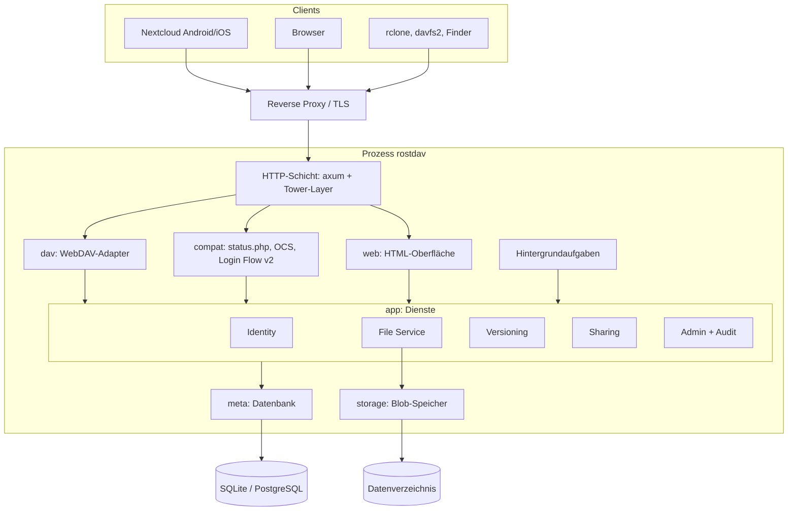

# Architektur

Stand: Vorschlag aus Phase 1, abhängig von der Freigabe von [ADR 0001](adr/0001-technologie-stack.md) und [ADR 0002](adr/0002-speichermodell.md).

## Überblick

Rostdav ist ein modularer Monolith: ein Prozess, ein Binary, klar getrennte Crates in einem Cargo-Workspace. Die Abhängigkeitsrichtung zeigt immer nach innen (Protokolle → Dienste → Domäne), der Compiler erzwingt sie über die Crate-Grenzen.

## Crates

| Crate | Verantwortung | Darf abhängen von |
|---|---|---|
| `rostdav-core` | Domänentypen (`UserId`, `NodeId`, `Etag`, `Permissions`, `LogicalPath`), Fehlertypen, Validierung von Namen und Pfaden | – |
| `rostdav-meta` | Schema, Migrationen, Repositories für alle Tabellen | core |
| `rostdav-storage` | `BlobStore`-Trait, Implementierung für das lokale Dateisystem, temporäre Dateien, atomares Ablegen | core |
| `rostdav-app` | Dienste: Identity, File Service, Versioning, Sharing, Admin, Audit, Hintergrundaufgaben; Autorisierung | core, meta, storage |
| `rostdav-dav` | WebDAV-Methoden, PROPFIND/PROPPATCH-XML, Nextcloud-Properties, Chunked Upload | core, app |
| `rostdav-compat` | `status.php`, Capabilities, OCS-Endpunkte (User, Sharing), Login Flow v2 | core, app |
| `rostdav-web` | HTML-Seiten (askama), Sitzungen, CSRF, statische Assets | core, app |
| `rostdav` (Binary) | Konfiguration, Verdrahtung, Router, CLI (`serve`, `admin …`) | alle |

Regel: Protokoll-Crates kennen weder Datenbank noch Dateisystem. Nur `rostdav-app` koordiniert `meta` und `storage`.

## Anfrageverarbeitung

Tower-Layer in dieser Reihenfolge:

1. **Request-ID und Tracing** – jede Anfrage bekommt eine ID; Logfelder werden zentral geschwärzt (`Authorization`, Cookies, Tokens).
2. **Limits** – Header-Größe, Body-Limit je Route (XML klein, Uploads groß), Timeouts.
3. **Trusted Proxy** – Client-IP und Schema nur aus konfigurierten Proxies übernehmen.
4. **Authentifizierung** – erzeugt einen `Principal`:
   - Basic Auth mit **App-Passwort** → `Principal { user, via: AppPassword(id) }`
   - Basic Auth mit **Kontopasswort** → nur erlaubt, wenn weder 2FA aktiv noch „WebDAV nur mit App-Passwörtern“ gesetzt ist
   - Sitzungs-Cookie → nur für `rostdav-web`
   - Öffentlicher Link-Token → eingeschränkter Principal für die Freigabe
5. **Rate Limiting** – pro IP und pro Benutzername auf alle Anmeldewege, inklusive Login-Flow-Polling und 2FA-Codes.
6. **CSRF** – nur für zustandsändernde Web-Routen.
7. **Handler** → Dienst → Autorisierung → Ergebnis → Fehlerabbildung.

### Fehlerabbildung

Ein zentraler Fehlertyp in `rostdav-core` (`NotFound`, `Forbidden`, `Conflict`, `PreconditionFailed`, `QuotaExceeded`, `Locked`, `TooLarge`, `BadRequest`, `Unavailable`, `Internal`). Jede Protokollschicht bildet ihn ab:

- WebDAV: Statuscodes nach RFC 4918, `<d:error>`-Body wie bei Nextcloud (Format in M5 aus Mitschnitten übernehmen)
- OCS: Envelope mit v1-/v2-Statuscodes
- Web: Fehlerseite ohne interne Details

`Internal` wird mit Request-ID geloggt, der Client sieht nur die ID.

## Autorisierung

- Jede Operation erhält `(Principal, NodeId, Aktion)`. Die effektiven Rechte ergeben sich aus Besitz oder Freigabe (Rechte-Bitmaske wie Nextcloud: lesen, ändern, anlegen, löschen, teilen).
- Pfade werden nur zum Auflösen benutzt; geprüft wird auf dem aufgelösten Knoten.
- Eine Funktion `authorize()` in `rostdav-app`, kein Handler prüft selbst. Negativtests decken jede Aktion ab.

## Pfadauflösung

1. URL-Pfad prozentdekodieren (genau einmal), UTF-8 erzwingen.
2. In Segmente teilen; leere Segmente, `.`, `..`, Steuerzeichen und `/` in Namen ablehnen.
3. Jedes Segment NFC-normalisieren, Längenlimit prüfen.
4. Über `nodes` ab dem Wurzelknoten des Principals bzw. Mountpunkt der Freigabe auflösen.
5. `Destination`-Header: nur gleicher Host und gleiche Basis-URL, dann wie oben.

## Datenmodell (Kern)

| Tabelle | Wichtige Spalten |
|---|---|
| `users` | id, login, display_name, email, password_hash, role, quota_bytes, used_bytes, disabled, theme, locale, created_at |
| `app_passwords` | id, user_id, name, token_hash, created_via (login_flow/manual), last_used_at, last_ip, created_at |
| `sessions` | id_hash, user_id, csrf_secret, expires_at, created_at, last_seen_at |
| `login_flows` | poll_token_hash, login_token_hash, client_name, state, user_id, app_password_id, expires_at |
| `totp` | user_id, secret_enc, enabled_at, last_used_step |
| `recovery_codes` | id, user_id, code_hash, used_at |
| `nodes` | siehe ADR 0002 |
| `blobs` | id, size, checksum, created_at |
| `versions` | id, node_id, blob_id, size, mtime, author_app_password_id, created_at |
| `shares` | id, node_id, owner_id, share_type (user/link), recipient_id, permissions, token_hash, password_hash, expires_at, mount_parent_id, created_at |
| `uploads` | id, user_id, target_node_path, total_length, expires_at |
| `upload_chunks` | upload_id, number, size, tmp_path |
| `audit_log` | id, at, actor_id, action, target, ip, details_json |
| `settings` | key, value_json, updated_by, updated_at |

Alle Tokens (App-Passwörter, Sitzungen, Login-Flow, Link-Token) werden nur als Hash gespeichert. App-Passwörter und Tokens sind hochentropisch, daher reicht für sie ein schneller Hash (SHA-256) mit zeitkonstantem Vergleich. Kontopasswörter und Link-Passwörter verwenden Argon2id.

## Hintergrundaufgaben

Laufen im selben Prozess als `tokio`-Tasks mit Intervall und Sperre gegen Doppelausführung:

| Aufgabe | Intervall |
|---|---|
| Abgelaufene Login-Flows, Sitzungen, Sperren entfernen | 5 min |
| Verwaiste Chunk-Uploads löschen | stündlich |
| Versionen nach Aufbewahrungsregeln ausdünnen | täglich |
| Blob-Bereinigung (Mark-and-Sweep) | täglich |
| Ereignisprotokoll nach Aufbewahrung kürzen | täglich |

Zustand und letzte Ausführung erscheinen unter Administration → Status.

## Konfiguration

Vorrang: Kommandozeile > Umgebungsvariablen (`ROSTDAV_*`) > Konfigurationsdatei (`rostdav.toml`) > Datenbank-Einstellungen aus der Oberfläche > Defaults. Werte aus den oberen drei Ebenen sind in der Oberfläche schreibgeschützt. Geheimnisse (Schlüssel für TOTP-Secrets, ggf. DB-Passwort) nur aus Umgebung oder Secret-Datei.

## Bedrohungsmodell (Kurzfassung, Details in `docs/security.md`)

| Bedrohung (STRIDE) | Beispiel | Maßnahme |
|---|---|---|
| Spoofing | Passwort-Raten über WebDAV | Rate Limit pro IP und Benutzer, App-Passwort-Pflicht optional, 2FA |
| Tampering | Pfad-Manipulation, `Destination` auf fremden Host | Physische Pfade unabhängig von Eingaben, strikte Validierung |
| Repudiation | Admin löscht Benutzer unbemerkt | Ereignisprotokoll für alle Admin- und Sicherheitsaktionen |
| Information Disclosure | Zugriff auf fremde Datei-ID, Fehlermeldung mit Pfad | Autorisierung pro Knoten, generische Fehler |
| Denial of Service | Riesige PROPFIND-Bäume, endlose Uploads | `Depth: infinity` aus, Limits, Timeouts, Quota |
| Elevation of Privilege | Benutzer ruft Admin-Route auf | Rollenprüfung im Dienst, nicht nur in der Oberfläche |

## Betrieb

- Ein Binary plus Datenverzeichnis (`db/`, `blobs/`, `tmp/`, `uploads/`), Container-Image auf Basis von `distroless` oder `scratch`.
- Betrieb hinter einem Reverse Proxy mit TLS; Rostdav selbst spricht HTTP auf localhost oder einem internen Netz.
- `/healthz` (Prozess lebt) und `/readyz` (Datenbank und Speicher erreichbar).
- Backup: SQLite-Online-Backup bzw. `pg_dump`, danach Blob-Verzeichnis. Da Blobs unveränderlich sind, ist diese Reihenfolge konsistent.
